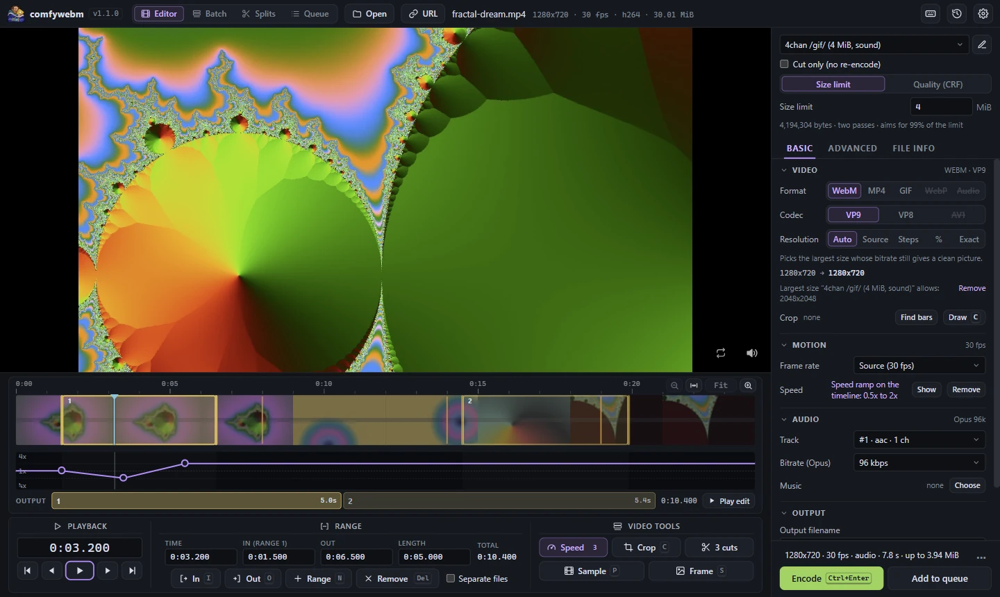
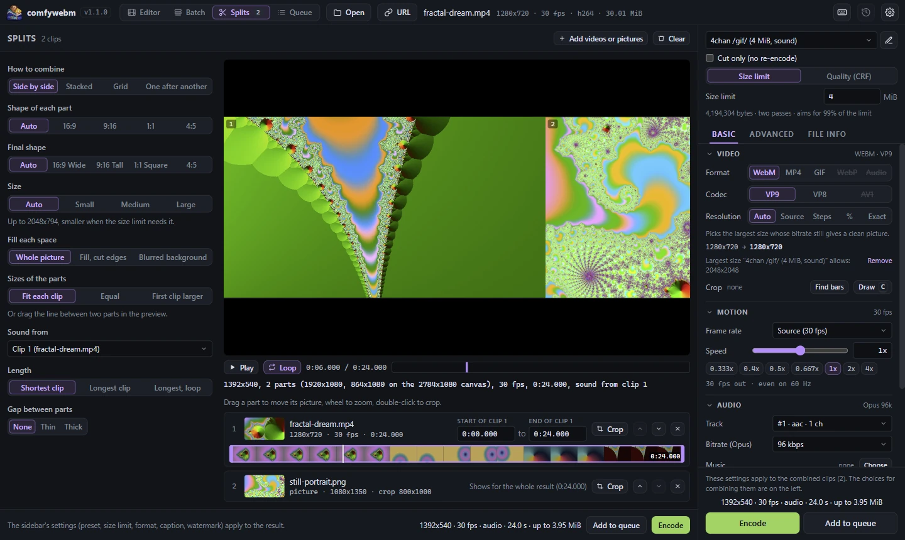
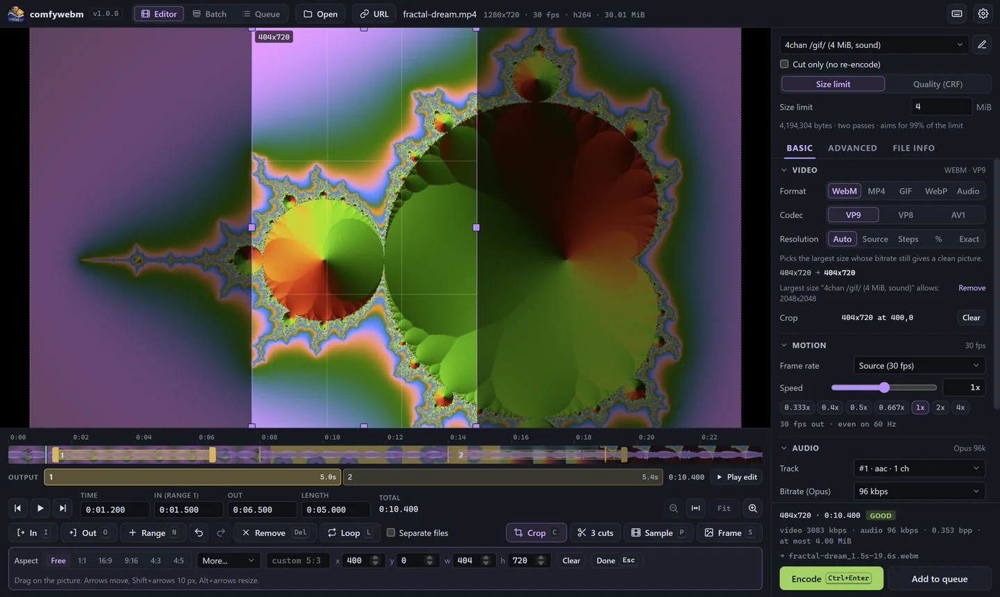
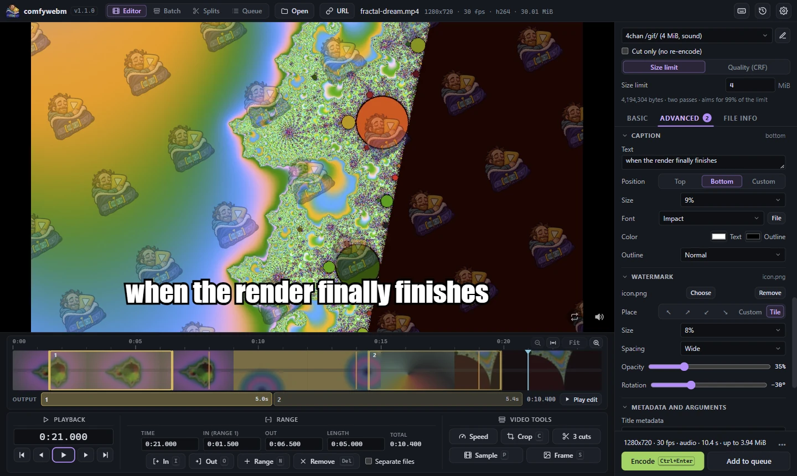
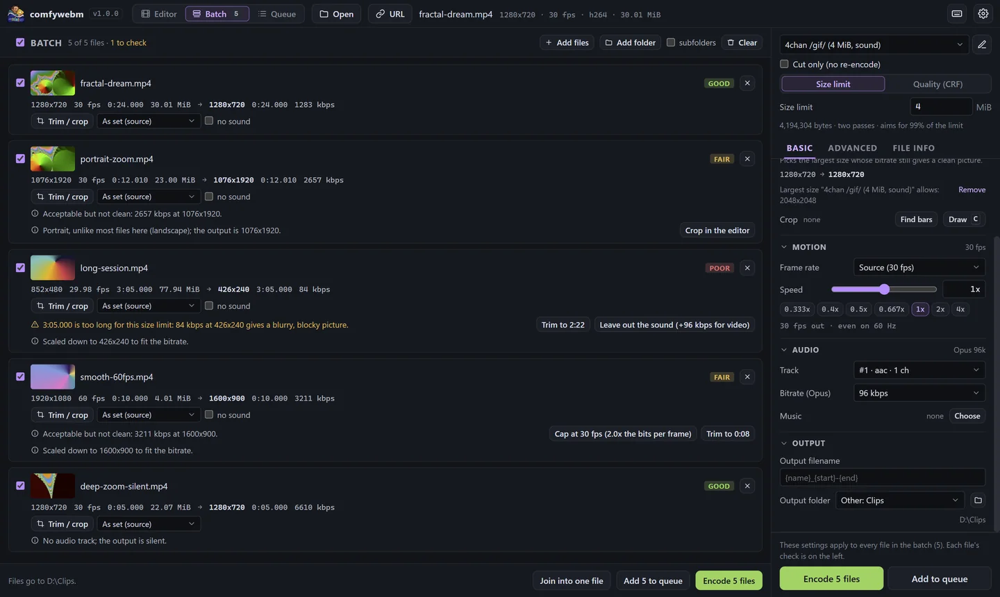
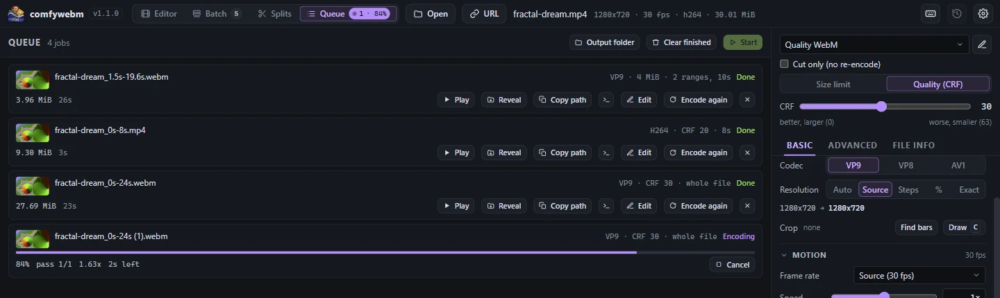
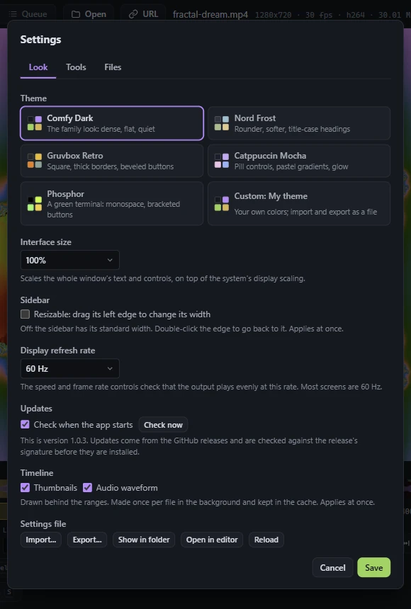
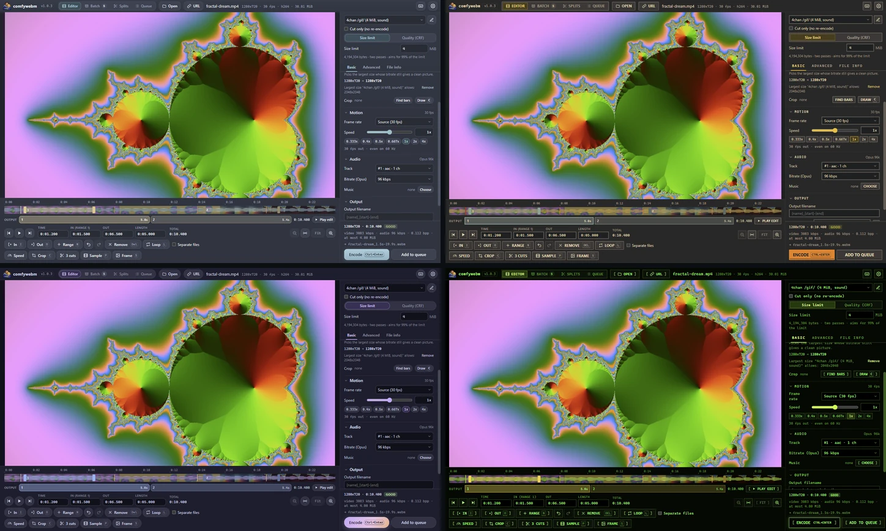

<div align="center">


<h1><samp>comfywebm</samp></h1>

<p>
  <b>Cut a clip out of any video and get a WebM, MP4, GIF or WebP that fits the size limit.</b><br>
  <i>Open a file or a link, mark the part you want, pick a preset, encode.</i>
</p>

<p>
  
  
  
  
  
  
</p>

<p>
  <a href="https://github.com/kpg-anon/comfywebm/releases/latest"></a>
</p>

<p>
  <b><a href="https://github.com/kpg-anon/comfywebm/releases/latest">Download</a></b> (Windows, macOS, Linux) · <a href="USAGE.md">Usage</a> · <a href="CHANGELOG.md">Changelog</a>
</p>

</div>

https://github.com/user-attachments/assets/fd259a47-d185-4969-8ff3-c63de58a245d

## Why

Image boards, Discord and X each have their own file size limit, and getting a
clip under it usually means guessing a bitrate, encoding, checking the size and
trying again. comfywebm does that part for you: it works out the bitrate from
the limit and the length, encodes in two passes, checks the result and encodes
again if the file came out too big. The preview shows the crop, speed,
rotation, colors, caption and watermark as you change them, so you see the
result before you encode.

It is a desktop app built on your own ffmpeg (and yt-dlp for web links). Nothing
is uploaded anywhere. Built with Tauri 2 (Rust) and Svelte 5; it runs on
Windows, Linux and macOS.

## Highlights

- **Fits the limit**: size mode encodes to 99% of the limit in two passes and
  tries again when the file is over it. Presets for 4chan, Discord and X, plus
  your own. Quality (CRF) mode when size does not matter.
- **Edit on the timeline**: several ranges per file, thumbnails and the audio
  waveform behind them, snapping, scene cut detection, undo and redo, frame
  stepping, loop playback.
- **Picture**: crop with aspect presets and black bar detection, rotate,
  mirror, speed from 0.25x to 4x with interpolation for slow motion, a speed
  ramp drawn on the timeline (the sound follows it), reverse and boomerang,
  fades, brightness / contrast / saturation / gamma / hue and a curve, HDR to
  SDR tone mapping.
- **On top**: captions in any installed font and color, at the top, bottom or
  dragged anywhere; a watermark in a corner, dragged anywhere or tiled
  (optionally turned, for diagonal rows); burned-in subtitles.
- **Formats**: WebM (VP9, VP8, AV1), MP4 (H.264, HEVC, AV1), GIF, animated
  WebP, and sound only (Opus, MP3, AAC). Cut-only stream copy when nothing
  else changes. Sound files with a picture become a video.
- **Splits**: combine videos and pictures of any size, shape and frame rate
  into one, side by side, stacked, in a grid or one after another. Pick the
  final shape, the shape of each part and the size from plain buttons; each
  clip fits its space whole, filled, or over a blurred copy, and can be
  cropped and zoomed. Drag the line between parts to size them by hand.
- **Many files**: a batch tab that checks every file against the settings and
  offers one-click fixes, joining files into one, and an encode queue that
  survives restarts.
- **Web links**: paste a link and pick the quality and the part to download
  (yt-dlp).
- **In-app updates** with the changelog of each release.

## Screenshots

<div align="center">
  
  <br><sub>The editor: preview, timeline with ranges, thumbnails, waveform and scene cuts, a speed ramp, and the settings on the right</sub>
</div>

<div align="center">
  
  <br><sub>Splits: a video beside a picture, with plain choices on the left, a live preview and each clip's trim track</sub>
</div>

| | |
|:--:|:--:|
|  |  |
| <sub>Crop drawn on the picture, with aspect presets</sub> | <sub>Caption and a tiled watermark turned 30 degrees</sub> |
|  |  |
| <sub>Batch: every file checked against the settings, with one-click fixes</sub> | <sub>Queue: progress, attempts, Play, Reveal</sub> |
|  |  |
| <sub>Settings: themes, interface size, updates, settings file</sub> | <sub>Five theme presets and your own colors</sub> |

## Install

**[Latest release](https://github.com/kpg-anon/comfywebm/releases/latest)**. Pick the file for your system:

| system | file | updates |
| :-- | :-- | :-- |
| Windows 10 / 11 (x64), installer | `comfywebm_1.1.1_x64-setup.exe` | in the app |
| Windows 10 / 11 (x64), portable | `comfywebm_1.1.1_x64-portable.zip` | download the new zip |
| macOS 11+, Apple silicon (M1 and later) | `comfywebm_1.1.1_aarch64.dmg` | in the app |
| macOS 11+, Intel | `comfywebm_1.1.1_x64.dmg` | in the app |
| Linux (x64): Ubuntu 22.04, Debian 12, Fedora 36 or newer | `comfywebm_1.1.1_amd64.AppImage` | in the app |
| Debian, Ubuntu, Mint | `comfywebm_1.1.1_amd64.deb` | download the new `.deb` |
| Fedora, openSUSE | `comfywebm-1.1.1-1.x86_64.rpm` | download the new `.rpm` |

comfywebm uses your own **ffmpeg** (and **yt-dlp** for web links); neither is
bundled. When one is missing, the app says which and how to get it.

### Windows

Run the installer. It installs for your user only (no administrator rights),
and adds a Start menu entry and an uninstaller. It is not code-signed, so
SmartScreen may warn the first time: **More info**, then **Run anyway**.

**Portable**: unzip anywhere (a USB stick works) and run `comfywebm.exe`. The
file named `portable` beside it makes the app keep its settings, presets,
queue, cache and remembered options in a `data` folder there instead of in
your user profile; delete that file to use the normal locations. To update,
unzip the new version over the folder; `data` stays. The portable copy needs
the WebView2 runtime, which Windows 10 and 11 have.

ffmpeg and yt-dlp: press Install ffmpeg and Install yt-dlp when the app says
they are missing (or in Settings > Tools). To use your own instead: the "full"
build from [gyan.dev](https://www.gyan.dev/ffmpeg/builds/)
(`winget install Gyan.FFmpeg`) and `winget install yt-dlp`.

### macOS

Open the `.dmg` and drag comfywebm to Applications. The app is not notarized
by Apple, so the first start is refused ("cannot be opened" or "is damaged").
Run this once in Terminal, then open it as usual:

```sh
xattr -cr /Applications/comfywebm.app
```

Or: try to open it once, then System Settings > Privacy & Security > **Open
Anyway** (on macOS 14 and older, right-click the app > **Open** also works).

ffmpeg and yt-dlp: Install ffmpeg in the app runs `brew install ffmpeg-full`
(needs [Homebrew](https://brew.sh)); Install yt-dlp downloads it. Or install
them yourself with `brew install ffmpeg-full yt-dlp` (the plain `ffmpeg` formula
has no vid.stab). The app finds them in Homebrew's folders even when started
from the Dock.

### Linux

**AppImage**: make it executable and run it:

```sh
chmod +x comfywebm_*_amd64.AppImage
./comfywebm_*_amd64.AppImage
```

It needs FUSE 2 (`sudo apt install libfuse2`; on Ubuntu 24.04 `libfuse2t64`).

The AppImage is built on Ubuntu 22.04 and needs glibc 2.35 or newer (Ubuntu
22.04, Debian 12, Fedora 36 or newer).

**.deb / .rpm**: `sudo apt install ./comfywebm_*_amd64.deb` or
`sudo dnf install ./comfywebm-*.x86_64.rpm`.

ffmpeg and yt-dlp: press Install ffmpeg and Install yt-dlp in the app, or use
`sudo apt install ffmpeg` (Fedora: from RPM Fusion, `sudo dnf install ffmpeg`)
and `pipx install yt-dlp`.

## Updating

At start (Settings > Look > Updates; on by default) and with **Check now**,
the app asks GitHub for the latest release. When there is a newer one, a
notice shows its version and changelog, with **Update now** and **Later**.
Update now downloads the new version for your system, checks its signature
against the key built into the app, installs it and starts the app again. A
Linux `.deb` or `.rpm` install cannot replace itself; its notice links the
release page instead.

## Build from source

You need Rust (stable), Node.js 20 or newer, and the
[Tauri prerequisites](https://v2.tauri.app/start/prerequisites/) for your
system.

```sh
npm install
npm run tauri dev      # development build with hot reload
npx tauri build        # release build and installers
```

More in [USAGE.md](USAGE.md#building-from-source); releases are described in
[scripts/README.md](scripts/README.md).

## Documentation

- [USAGE.md](USAGE.md): every feature, the keys, the presets, the files the
  app keeps, privacy, and questions.
- [CHANGELOG.md](CHANGELOG.md): what changed in each version.

## License

**[MIT](LICENSE)** — © 2026 kpg-anon.
